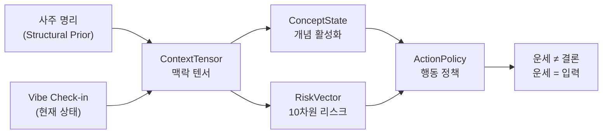

# TCO-Vibe 이론 타당성 · 효과성 · 대중 소구력 분석

---

## 1. 이론 구조 요약

TCO-Vibe Fortune Coach는 **두 개의 이론적 축**을 융합합니다:



### 축 1: TCO (Transformative Concept Orchestration)
> "운세는 결론이 아니라 입력값이다" — [system.md](file:///c:/Users/User/vibe-fortune/prompts/system.md#L18)

| 구성요소 | 정의 | 역할 |
|---------|------|------|
| **Structural Prior** | 사주·대운·세운·월운·일운의 결정론적 계산 결과 | 에너지 구조의 방향 제시 (확정이 아님) |
| **ContextTensor** | 6축 복합 맥락 (domain, userState, risk, intent, evidence, temporal) | 해석의 다차원 좌표계 |
| **ConceptState** | 활성/억제/갭 개념 목록 + 신뢰도 | 어떤 패턴이 작동 중인지 명시 |
| **RiskVector** | 10차원 리스크 스코어 (0~1) | 경고/금지 행동의 근거 |
| **ActionPolicy** | mode(확장/정리/정돈/회복) + required/forbidden/deferred 행동 | **최종 출력물** |

### 축 2: Vibe (현재 심리-신체 상태)
| 차원 | 범위 | 의미 |
|------|------|------|
| valence | 0~10 | 감정 긍정/부정 |
| arousal | 0~10 | 각성 수준 |
| energy | 0~10 | 에너지 수준 |
| focus | 0~10 | 집중도 |
| socialLoad | 0~10 | 사회적 부하 |

---

## 2. 이론적 타당성 평가

### ✅ 타당한 점 (강점)

#### 2.1 결정론적 계산과 LLM 해석의 완전 분리
> "Manse Engine이 계산한다. 당신은 계산하지 않는다." — [system.md L25](file:///c:/Users/User/vibe-fortune/prompts/system.md#L25)

이것은 **아키텍처적으로 정직한 설계**입니다:
- 천문학적 계산(절기, 간지, JDN 기반 일진)은 **검증 가능한 결정론적 알고리즘**
- LLM은 "계산된 구조를 자연어로 번역하는" 역할만 수행
- 기존 사주 서비스에서 LLM이 간지를 직접 "추측"하는 오류를 원천 차단

> [!TIP]
> **학술적 유사체**: 이는 "model-view" 분리 원칙의 운세 버전. 계산 모델(manse engine)과 표현 뷰(LLM)의 관심사 분리는 소프트웨어 공학적으로 건전.

#### 2.2 Vibe Check-in의 심리학적 근거

5축 Vibe 시스템은 **정서 과학(Affective Science)**의 검증된 모델에 기반합니다:

| Vibe 축 | 학술적 근거 |
|---------|------------|
| valence + arousal | **Russell의 Circumplex Model of Affect (1980)** — 정서를 valence(쾌/불쾌)와 arousal(고/저각성)의 2축으로 모델링 |
| energy | **Thayer의 Biopsychological Model (1989)** — energetic arousal과 tense arousal 구분 |
| focus | **Csikszentmihalyi의 Flow Theory (1990)** — 집중도는 최적 경험의 핵심 지표 |
| socialLoad | **Baumeister의 Self-Regulation Depletion (1998)** — 사회적 상호작용은 자기조절 자원을 소모 |

> [!IMPORTANT]
> 이 5축은 "감이 아니라 구조"입니다. 사용자가 직접 보고하는 자기 상태(self-report)와 구조적 사전값(사주)의 **교차점**에서 행동 정책이 생성됩니다. 이것이 "나는 괜찮다고 느끼지만, 구조적으로는 회복이 필요한 시기"라는 통찰을 가능하게 합니다.

#### 2.3 행동 정책(ActionPolicy)이 최종 출력

기존 사주 서비스: `차트 → 운명 예언 → "좋은 날/나쁜 날"`
TCO-Vibe: `차트 + Vibe → 맥락 분석 → 행동 정책 → "오늘 이것을 하라/하지 마라"`

이 전환은 **행동과학(Behavioral Science)**의 핵심 원칙과 일치합니다:
- **Implementation Intentions** (Gollwitzer, 1999): 구체적 행동 계획이 추상적 의도보다 실행률 2~3배 높음
- **Nudge Theory** (Thaler & Sunstein, 2008): 선택 설계를 통한 행동 유도
- **Psychological Safety** (Edmondson, 1999): forbiddenActions가 "하지 마라"를 명시함으로써 심리적 안전 구간 설정

#### 2.4 10차원 리스크 벡터의 운영적 가치

```typescript
// risk-vector.schema.ts에서 발췌
overextension     // 과확장
scopeLeak         // 범위 누수
overclaim         // 과대 주장
burnout           // 번아웃
relationshipDryness // 관계 건조
emotionalOverreaction // 감정적 과잉반응
legalSafetyRisk   // 법적 안전 리스크
missedOpportunity // 기회 놓침
deterministicFortuneRisk  // 결정론적 운세 리스크 (항상 0)
relationshipManipulationRisk // 관계 조작 리스크 (항상 0)
```

마지막 두 차원(`deterministicFortuneRisk`, `relationshipManipulationRisk`)이 **항상 0으로 고정**되어 있다는 것은 이 시스템이 자기 자신의 윤리적 경계를 **구조적으로** 강제한다는 의미입니다. 이것은 단순한 프롬프트 지시가 아닌 **스키마 레벨의 안전 설계**입니다.

#### 2.5 Safety Gate의 3중 구조

```
Input SafetyGate → Forecast SafetyBoundaryReviewer → Persistence with safetyFlags
```

9가지 안전 플래그 유형(self_harm, medical, legal, investment, relationship_manipulation, fear_amplification, deterministic_prediction, overclaim, missing_boundary)은 **구체적이고 검증 가능한** 안전 분류 체계입니다.

---

### ⚠️ 취약점/보완 필요 사항

#### 2.6 사주 명리 자체의 과학적 지위

> [!CAUTION]
> 사주 명리(四柱命理)는 현대 과학에서 **실증적으로 검증된 예측 체계가 아닙니다**. 생년월일시와 인생 경로 사이의 인과 관계는 통제된 실험에서 입증된 바 없습니다.

**그러나** TCO-Vibe는 이 한계를 다음과 같이 상쇄합니다:
- 사주를 **"예측"이 아닌 "구조적 prior"로 재정의** — 확정이 아닌 참고값
- LLM이 최종 행동 정책을 생성할 때 **Vibe(실제 사용자 상태)가 동등한 입력**
- "운세는 운명이 아니다"를 시스템 프롬프트의 **첫 번째 원칙**으로 명시

> 이 접근은 "타로/사주가 자기성찰의 도구(tool for self-reflection)로서 가치가 있다"는 **문화심리학적 관점**과 일치합니다.

#### 2.7 Vibe Self-Report의 편향

자가 보고(self-report)에는 고유한 한계:
- **사회적 바람직성 편향**: 실제보다 긍정적으로 보고
- **알렉시시미아**: 자신의 감정을 정확히 인식하지 못하는 사용자
- **앵커링 효과**: 이전 보고 값에 고착

**보완 제안**: Vibe 히스토리의 급격한 변동 패턴 감지 → "평소와 다른 패턴" 알림

#### 2.8 "mode" 결정의 투명성

현재 Expansion/Consolidation/Cleanup/Recovery 모드 결정은 LLM에 의존합니다. 이 결정의 **재현 가능성(reproducibility)**이 보장되지 않습니다.

**보완 제안**: mode 결정을 결정론적 규칙 기반으로 전환 (Vibe 조합 테이블 → mode 매핑)

---

## 3. 기존 사주 서비스 대비 차별화

| 평가 축 | 기존 상용 서비스 | TCO-Vibe |
|---------|----------------|----------|
| **계산** | Black-box 또는 LLM 추측 | 검증 가능한 결정론적 엔진 |
| **출력** | "오늘 운이 좋다/나쁘다" | "오늘 확장 모드: A를 하라, B를 하지 마라" |
| **사용자 입력** | 생년월일시만 | 생년월일시 + 5축 Vibe + 개인 맥락 |
| **안전** | 없거나 약함 | 9유형 SafetyFlag + 3중 게이트 |
| **투명성** | Black-box | ConceptState + OperatorTrace + RiskVector 공개 |
| **피드백** | 없음 | RLHF 기반 개인화 + 투명성 배너 |
| **윤리** | 공포 마케팅 빈번 | 공포 증폭 구조적 차단 |

---

## 4. 대중 소구 포인트

### 🎯 핵심 메시지 후보

#### A. "운세를 읽는 게 아니라 실행하는 것"
> 가장 강력한 포지셔닝. 기존 운세 앱이 "읽고 끝"인 것에 비해, **오늘 할 일/하지 말 일**을 주는 것이 핵심 차별점.

**소구 대상**: 30~40대 직장인/창업자 — "운세가 재밌긴 한데, 뭘 어쩌란 건지 모르겠다"는 사용자

#### B. "AI가 당신의 사주를 읽는 게 아닙니다. 수학이 계산하고 AI가 번역합니다."
> 계산의 정직성을 강조. "LLM이 사주를 맞춘다"는 오해를 차단하면서, 기술적 신뢰를 구축.

**소구 대상**: 기술 리터러시가 높은 2030 — "사주가 과학은 아니지만, 적어도 계산은 정확한지 궁금하다"

#### C. "오늘 컨디션이 운세를 바꿉니다"
> Vibe Check-in의 가치를 강조. "같은 사주라도 오늘 상태에 따라 다른 행동 정책"이라는 점은 **반복 사용 동기**를 만듦.

**소구 대상**: 일상 기록(다이어리/습관 트래커) 사용자 — "오늘의 나 상태를 체크하고, 거기에 맞는 가이드가 나온다"

#### D. "무서운 말 하지 않습니다. 구조적으로."
> 기존 사주 서비스의 **공포 마케팅**에 지친 사용자에게 강력한 소구. 9가지 SafetyFlag가 구조적으로 공포 증폭을 차단한다는 점.

**소구 대상**: 운세 보고 불안해진 경험이 있는 사용자

#### E. "왜 그런 결과가 나왔는지 다 보여드립니다"
> ConceptActivationPanel, OperatorTracePanel, RiskVector 시각화 — 기존 서비스의 Black-box와 정반대.

**소구 대상**: 투명성을 중시하는 사용자, "근거 없는 운세는 안 본다"는 회의론자

---

### 📊 소구 전략 우선순위 매트릭스

| 소구 포인트 | 대중성 | 차별성 | 실증 가능성 | **종합** |
|------------|--------|--------|------------|---------|
| A. 실행하는 운세 | ★★★★★ | ★★★★☆ | ★★★★★ | **1위** |
| C. 컨디션이 운세를 바꿈 | ★★★★☆ | ★★★★★ | ★★★★☆ | **2위** |
| D. 무서운 말 안 함 | ★★★★☆ | ★★★★☆ | ★★★★★ | **3위** |
| E. 투명한 근거 공개 | ★★★☆☆ | ★★★★★ | ★★★★★ | **4위** |
| B. 수학+AI 분리 | ★★☆☆☆ | ★★★★★ | ★★★★★ | **5위** |

---

## 5. 종합 평가

### TCO-Vibe 이론은 **충분히 타당하고 효과적**인가?

| 차원 | 평가 | 근거 |
|------|------|------|
| **아키텍처적 타당성** | ✅ 매우 높음 | 계산-해석 분리, 스키마 검증, Safety Gate 3중 구조 |
| **심리학적 근거** | ✅ 높음 | Circumplex Model, Flow Theory, Implementation Intentions 기반 |
| **윤리적 건전성** | ✅ 매우 높음 | 9가지 SafetyFlag, 리스크 벡터의 윤리 차원 고정, 면책 3단계 |
| **과학적 실증성** | ⚠️ 부분적 | 사주 자체는 미검증이나, "prior로서의 활용"은 합리적 재정의 |
| **상업적 차별성** | ✅ 매우 높음 | 기존 사주 앱과 완전히 다른 패러다임 (예언 → 행동 정책) |
| **반복 사용 동기** | ✅ 높음 | Vibe 변화 → 다른 결과, 7일/30일/90일 트렌드, 대화형 Chat |

### 한 줄 결론

> **TCO-Vibe는 "사주를 과학으로 만들려는 시도"가 아니라, "사주를 행동과학의 프레임에 넣어 실용적 자기운영 도구로 전환하는 시도"이며, 이 재정의 자체가 이 시스템의 가장 큰 학술적·상업적 가치입니다.**
