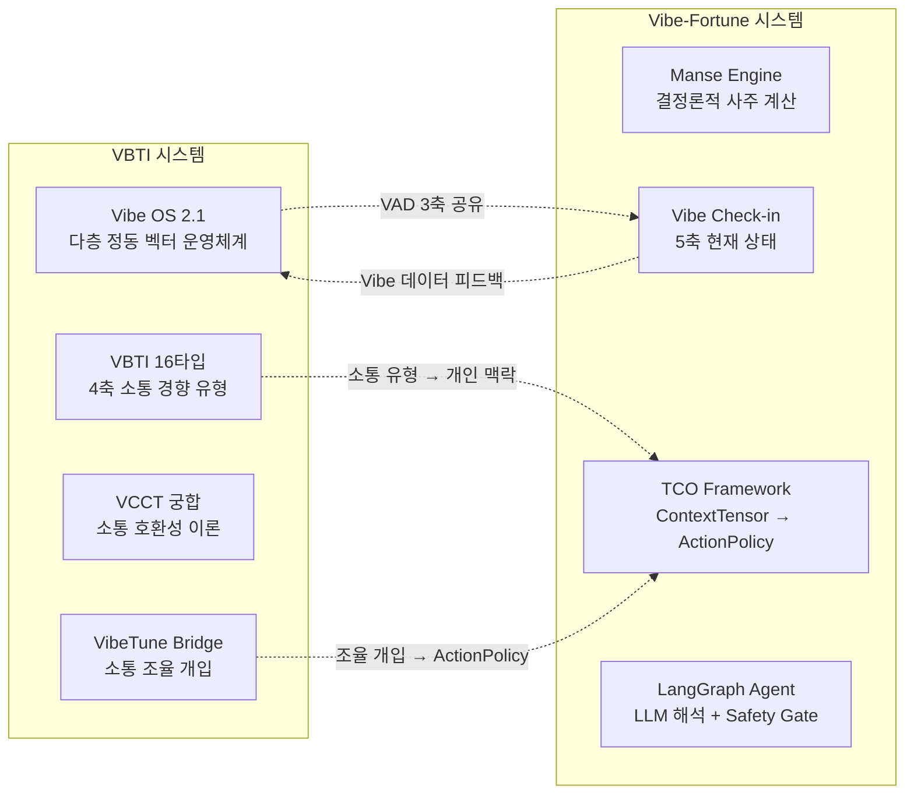
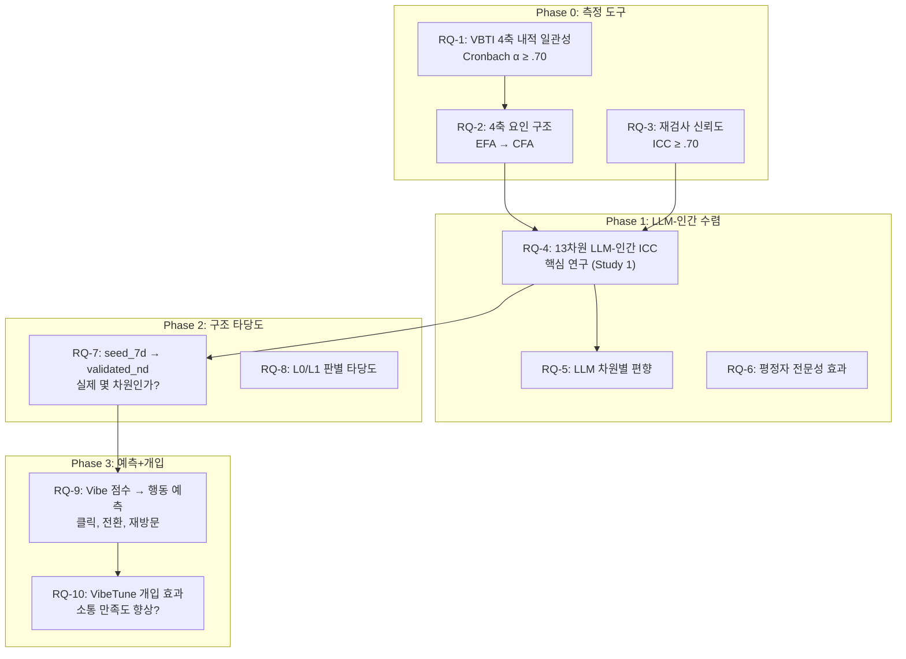
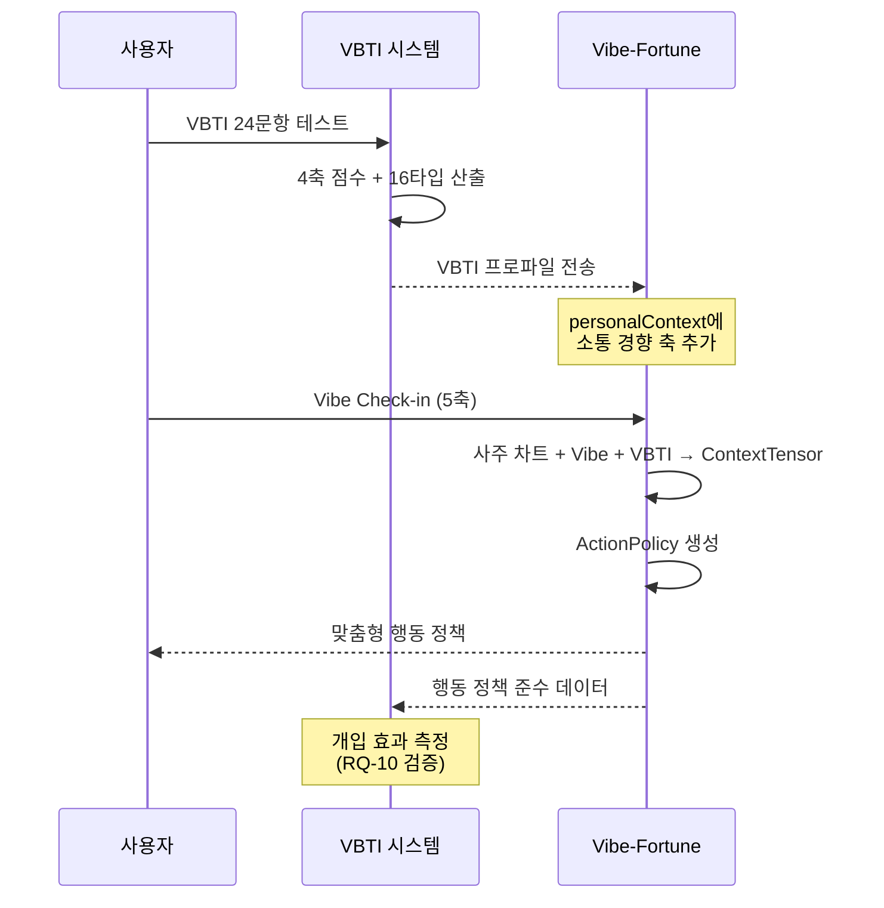
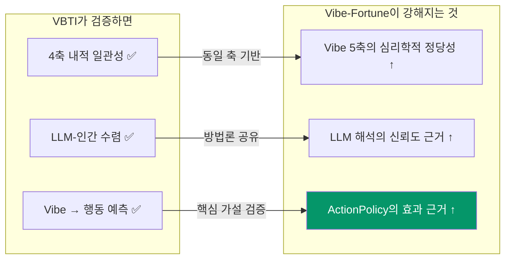

# VBTI × Vibe-Fortune 시스템 연계 분석

---

## 1. 두 시스템의 정체성



| 차원 | VBTI | Vibe-Fortune |
|------|------|-------------|
| **이름** | VibeCheck VBTI MVP | TCO-Vibe Fortune Coach v2 |
| **핵심 질문** | "당신은 어떤 소통 경향을 가졌는가?" | "오늘 당신은 무엇을 해야 하는가?" |
| **이론 기반** | 정동 과학 (Russell, Kiesler, SDT, SCM) | 사주 명리 + 행동과학 (Gollwitzer, Nudge) |
| **측정 방식** | 24문항 5점 척도 + LLM 보조 평정 | 5축 Vibe + 결정론적 차트 계산 |
| **출력** | 16타입 코드 + 소통 조율 가이드 | 행동 정책 (do/don't/defer) |
| **과학적 지위** | "검증 가능하게 정식화된 가설" | "사주를 행동과학 프레임에 전환" |
| **검증 상태** | Study 1 PAP 준비 완료, 실증 데이터 0건 | Safety Gate 테스트 통과, 실증 데이터 0건 |
| **스택** | Next.js + Supabase + Tailwind | Next.js + Supabase + LangGraph |

---

## 2. 공유하는 핵심 개념

### 2.1 Vibe 5축 ↔ VAD + Context

두 시스템은 **Russell의 Circumplex Model**을 공통 기반으로 사용합니다.

| Vibe-Fortune 축 | VBTI/Vibe OS 대응 | 공통 이론 |
|----------------|-------------------|----------|
| `valence` (0~10) | `vad_valence` (-1~+1) | Russell(1980) Circumplex |
| `arousal` (0~10) | `vad_arousal` (-1~+1) | Russell(1980) Circumplex |
| `energy` (0~10) | VBTI C/V축 (Calm↔Vivid) | Thayer(1989) + Russell |
| `focus` (0~10) | L1 `groundedness` | Csikszentmihalyi Flow |
| `socialLoad` (0~10) | VBTI W/K축 (Warm↔Kompetent) | Kiesler(1983) IPC |

> [!IMPORTANT]
> **핵심 발견**: Vibe-Fortune의 5축은 사실상 **VBTI/Vibe OS의 L0 Core Affect + L1 일부**를 간소화한 버전입니다. 두 시스템은 동일한 심리학적 좌표계를 서로 다른 해상도로 측정하고 있습니다.

### 2.2 비본질화 원칙 (Anti-Essentialization)

| 원칙 | VBTI 표현 | Vibe-Fortune 표현 |
|------|----------|-----------------|
| 비결정론 | "현재 응답 기준의 Vibe 소통 경향" | "운세는 운명이 아니다. 구조적 prior다" |
| 비낙인 | "당신은 원래 이런 사람입니다" 금지 | "반드시 ~할 것이다" 금지 |
| 행동 전환 | "궁합은 좋음/나쁨이 아니라 소통 보완법" | "운세는 결론이 아니라 입력값" |
| 사용자 자율 | "고정 진단이 아닌 소통 지침" | "사용자가 최종 의사결정자" |

> 두 시스템이 **동일한 윤리적 DNA**를 공유합니다. 이것은 우연이 아니라, 같은 설계 철학에서 나왔기 때문입니다.

### 2.3 Safety/Compliance 구조

| VBTI | Vibe-Fortune |
|------|-------------|
| `complianceSanitizer` | `checkInputSafety` / `checkOutputSafety` |
| "최악의 궁합" 금지 | "결정론적 예측" 금지 |
| 민감 속성 추론 금지 | `deterministicFortuneRisk = 0` 고정 |

---

## 3. VBTI가 실험적으로 검증하려는 것

VBTI의 연구 프로그램은 **7개 마스터 가설(H1~H7)**과 **9개 이상의 연구 질문(RQ)**으로 구성됩니다:

### 3.1 연구 프로그램 전체 지도



### 3.2 Vibe-Fortune과의 관계성

| VBTI 연구 | Vibe-Fortune에서의 의미 | 관계 유형 |
|----------|----------------------|----------|
| **RQ-1: VBTI 4축 내적 일관성** | Vibe-Fortune의 Vibe 5축도 동일한 내적 일관성 검증이 필요 | 🔄 **방법론 공유** |
| **RQ-4: 13차원 LLM-인간 수렴** | Fortune Coach의 LLM 해석이 인간 직관과 얼마나 수렴하는지 | 🔄 **방법론 공유** |
| **RQ-7: seed_7d → validated_nd** | Fortune의 오행 5행이 "실제 인간 지각에서 5개로 분리되는가?" | 🧬 **구조적 유사 문제** |
| **RQ-9: Vibe → 행동 예측** | **Fortune의 핵심 가설 — ActionPolicy가 실제 행동 변화를 예측하는가?** | 🎯 **직접 검증 대상** |
| **RQ-10: VibeTune 개입 효과** | Fortune의 "행동 정책"이 실제 행동 변화를 만드는가? | 🎯 **직접 검증 대상** |

> [!CAUTION]
> **RQ-9과 RQ-10은 Vibe-Fortune의 존재 근거를 직접 검증합니다.** VBTI에서 "Vibe 측정 → 행동 예측"이 실증적으로 확인되면, Vibe-Fortune의 "Vibe → ActionPolicy → 행동 변화" 파이프라인의 **전반부**가 검증됩니다.

---

## 4. 연계 아키텍처 제안

### 4.1 데이터 파이프라인 통합



### 4.2 구체적 통합 포인트 5가지

#### ① VBTI 프로파일 → PersonalContext 확장

```typescript
// Vibe-Fortune의 PersonalContextSchema에 VBTI 데이터 추가
const PersonalContextSchema = z.object({
  // ... 기존 필드 ...
  vbtiType: z.string().optional(),      // e.g. "CWGA"
  vbtiAxes: z.object({
    cv: z.number().min(0).max(1),        // Calm↔Vivid
    wk: z.number().min(0).max(1),        // Warm↔Kompetent
    gs: z.number().min(0).max(1),        // Gain↔Safety
    ao: z.number().min(0).max(1),        // Authentic↔Ordered
  }).optional(),
});
```

**효과**: ActionPolicy 생성 시 소통 경향을 반영.
- `W` 경향 높은 사용자 → Warmth 모드 기본값
- `K` 경향 높은 사용자 → Competence 모드 기본값
- `S` 경향 높은 사용자 → Recovery 모드 threshold 하향

#### ② Vibe 5축 ↔ Vibe OS L0 좌표 변환

```typescript
// Vibe-Fortune의 0~10 → Vibe OS의 -1~+1 변환
function vibeToVAD(vibe: VibeCheckIn): VAD {
  return {
    valence: (vibe.valence - 5) / 5,    // 0~10 → -1~+1
    arousal: (vibe.arousal - 5) / 5,
    control: (10 - vibe.socialLoad - 5) / 5,  // socialLoad 반전
  };
}
```

**효과**: Vibe-Fortune의 일일 Vibe 데이터가 VBTI의 Vibe OS L0 좌표계로 자동 변환되어, 종단적 정동 추적 데이터로 활용 가능.

#### ③ VBTI 궁합 → Fortune 관계 도메인 강화

VCCT의 궁합 이론이 Fortune의 `relationship_love` 도메인 ActionPolicy를 강화:

```typescript
// 사용자의 VBTI 타입 + 상대방 VBTI 타입 → 소통 조율 전략
if (userVBTI.wk < 0.5 && partnerVBTI.wk >= 0.5) {
  // Warm + Kompetent 상보형 → 소통 보완 전략
  actionPolicy.boundaryNotes.push(
    "상대방은 핵심 중심 소통을 선호합니다. 감정 먼저, 요점은 간결하게."
  );
}
```

#### ④ Fortune 행동 데이터 → VBTI RQ-9/RQ-10 검증

Vibe-Fortune의 **RunReceipt + RLHF 피드백**이 VBTI의 "Vibe → 행동 예측" 가설을 직접 검증:

| Fortune 데이터 | VBTI 연구 활용 |
|--------------|---------------|
| Vibe Check-in 5축 (일별) | L0 Core Affect 종단 추적 |
| ActionPolicy mode 분포 | 개입 유형별 분포 |
| RLHF 별점 (1~5) | 사용자 만족도 → 행동 예측력 |
| requiredActions 실행 여부 | 개입 효과 직접 측정 (RQ-10) |
| forecast-grade-history | 등급 변화 추이 → 행동 변화 proxy |

#### ⑤ VibeTune → ActionPolicy sensoryPrescription

VBTI의 VibeTune Bridge가 Fortune의 `sensoryPrescription`을 데이터 기반으로 강화:

```typescript
// VibeTune의 소통 조율 → Fortune의 감각 처방
sensoryPrescription: {
  color: vibeTune.recommendedColor,     // 오행 + 소통 경향 매칭
  rhythm: vibeTune.communicationTempo,  // C/V축 기반 리듬 제안
  ritual: vibeTune.tuningRitual,        // 소통 전 준비 의식
}
```

---

## 5. 연구 시너지: 무엇이 검증되면 무엇이 강해지는가



| VBTI 검증 결과 | Vibe-Fortune에 미치는 영향 | 중요도 |
|--------------|------------------------|--------|
| VBTI 4축 Cronbach α ≥ .70 | Vibe 5축의 측정 신뢰도 논거 강화 | ★★★☆☆ |
| 13차원 LLM-인간 ICC ≥ .70 | Fortune Coach LLM의 정동 해석 신뢰도 근거 | ★★★★☆ |
| seed_7d → validated_nd 확인 | 오행 5행 분류의 심리학적 정당화 가능성 | ★★★☆☆ |
| **Vibe 점수 → 행동 예측 확인** | **ActionPolicy가 실제 행동에 영향을 줄 수 있다는 핵심 근거** | ★★★★★ |
| **VibeTune 개입 → 만족도 향상** | **Fortune의 "행동 정책 = 개입"이 효과 있다는 직접 근거** | ★★★★★ |

> [!IMPORTANT]
> **결론**: VBTI는 Vibe-Fortune의 **과학적 백본(scientific backbone)**입니다.
>
> - VBTI가 "Vibe 측정이 타당하다"를 검증하면 → Fortune의 Vibe Check-in이 정당화됩니다.
> - VBTI가 "LLM 평정이 인간과 수렴한다"를 검증하면 → Fortune의 LLM 해석이 정당화됩니다.
> - VBTI가 "Vibe → 행동 예측"을 검증하면 → Fortune의 **존재 이유 전체**가 정당화됩니다.
>
> 역으로 Vibe-Fortune은 VBTI에 **일일 종단 데이터(daily longitudinal data)**를 제공합니다. VBTI의 "1회성 측정"을 Fortune의 "매일 반복 측정"으로 보완하여, 정동 상태의 시간적 안정성과 변동성을 추적할 수 있습니다.

---

## 6. 통합 로드맵 제안

| 단계 | 작업 | VBTI 측 | Fortune 측 |
|------|------|--------|-----------|
| **P0** | API 연동 설계 | VBTI 결과 API 개방 | PersonalContext에 VBTI 통합 |
| **P1** | 좌표 변환 구현 | VAD 변환 함수 | vibeToVAD 변환 함수 |
| **P2** | 데이터 공유 파이프라인 | 일일 Vibe 수신 API | RunReceipt/RLHF 공유 API |
| **P3** | Study 1 실행 | 13차원 LLM-인간 수렴 검증 | Fortune LLM도 동일 자극으로 평가 |
| **P4** | 행동 예측 실험 | Vibe → 행동 예측 회귀분석 | ActionPolicy → 행동 변화 A/B 테스트 |
| **P5** | 통합 보고서 | 논문 게재 (BRM/Frontiers) | 제품 랜딩에 연구 근거 인용 |
